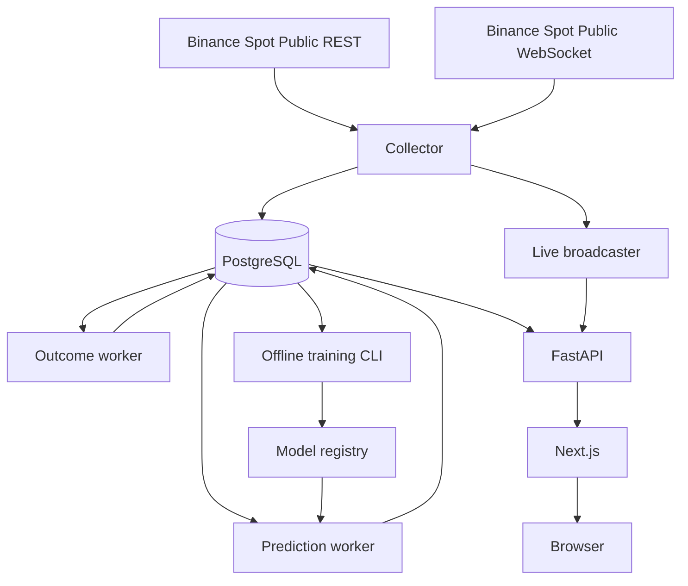
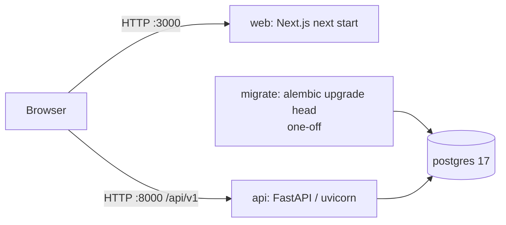

# Architecture

## Target system

## Implemented in M0

| Service | Image | Role | Health check |
|---|---|---|---|
| `postgres` | `postgres:17.6-bookworm` | Canonical data store; volume `pgdata` | `pg_isready` |
| `migrate` | `cryptopulse-backend:dev` | Runs `alembic upgrade head` once, then exits 0 | — (completion gate) |
| `api` | `cryptopulse-backend:dev` | Read-only REST API | `GET /api/v1/system/health` |
| `web` | `cryptopulse-web:local` | Next.js production build | `GET /` |

Startup order: `postgres` (healthy) → `migrate` (completed) → `api` (healthy) → `web`. The API and
workers never run migrations themselves.

### Backend layout (`services/backend/app`)

| Module | Responsibility |
|---|---|
| `core/config.py` | Typed settings; validates symbol whitelist, horizons, CORS and DB URL |
| `core/logging.py`, `core/middleware.py` | JSON logs, request id, access log |
| `core/errors.py` | Error codes and standard envelope; no stack traces to clients |
| `domain/enums.py` | Canonical contract enums (symbols, intervals, horizons, classes, statuses) |
| `db/`, `models/` | SQLAlchemy base, naming convention, engine/session, ORM models |
| `services/readiness.py` | Dependency diagnostics |
| `api/v1/` | Versioned routers |

The frontend is described in [UI_UX.md](UI_UX.md).

## Browser vs container networking

The browser calls the API at `NEXT_PUBLIC_API_BASE_URL` (default `http://localhost:8000`, the host
port). Containers reach each other by service name (`postgres:5432`, `api:8000`). In M0 the web
server does not call the API server-side; any future server-side fetches must use an internal URL
such as `http://api:8000`, configured separately.

## Failure modes (M0)

| Failure | Behaviour |
|---|---|
| Database down | `readiness` returns 503 with `DATABASE_UNAVAILABLE`; `health` stays 200 (liveness) |
| Schema behind | `readiness` returns 503, component `schema` = error |
| API down | Web `/system` shows an explicit offline state with retry; other pages are static |
| No market data / model | Shown as `DATA_UNAVAILABLE` / `MODEL_UNAVAILABLE`; never placeholder values |
